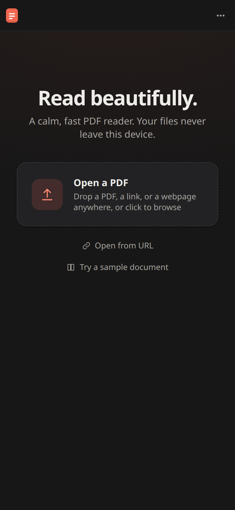
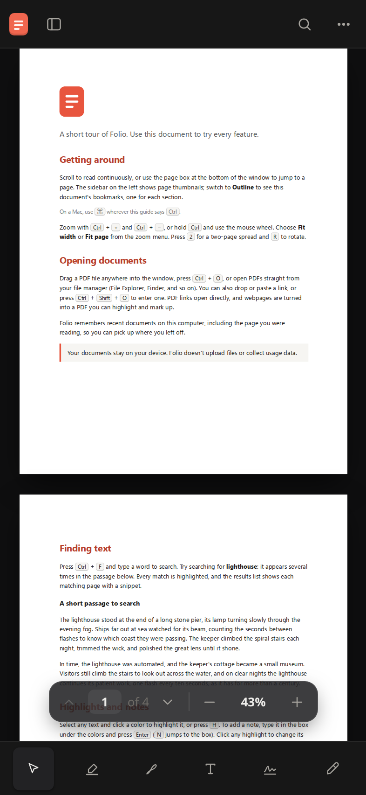
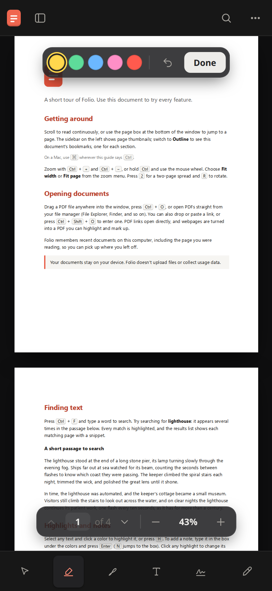

# Folio for Android

**[Folio](https://github.com/Forward-Future/folio), the calm, fast PDF reader — now on your Android phone.**
Read, highlight, draw, sign and edit PDFs. Everything stays on your phone: no account, no uploads.

  <a href="https://github.com/finexpmmaster2/folio-android/releases/latest/download/folio-android.apk"><b>⬇️ Download the APK</b></a>
  &nbsp;·&nbsp; <a href="https://github.com/finexpmmaster2/folio-android/releases">All releases</a>

| Open | Read | Highlight |
| --- | --- | --- |
|  |  |  |

## Install
1. On your phone, tap **Download the APK** above (or open the [latest release](https://github.com/finexpmmaster2/folio-android/releases/latest) and tap `folio-android.apk` under *Assets*).
2. Open the downloaded file. The first time, Android asks to allow installing apps from your browser or file manager:
   allow it once, then tap **Install**. (The APK isn't from the Play Store, so this step is normal.)
3. New versions install over the old one and keep your documents.

Android 7.0 or newer.

## What you can do
- **Open PDFs** from the app, or from any other app: **Open with → Folio for Android** (Files, Downloads, browsers)
  and **Share → Folio for Android** (Telegram, WhatsApp, Gmail…).
- **Read comfortably:** continuous scrolling, **pinch to zoom**, page jump, thumbnails, outline and bookmarks, search,
  PDF dark mode, focus mode.
- **Mark up:** highlight in colours with notes, draw, add text, **sign**, and edit existing text and images.
- **Save and share:** *Save copy* opens Android's share sheet, so you can save to Files or Drive or send it on.
- **One-handed:** on phones the tools sit in a bottom bar within thumb reach; the page and zoom controls float above it.

Not on Android (yet): Ask AI (it uses the desktop app's ChatGPT/Claude sign-in), printing, and automatic updates —
new versions come as a new APK on the [Releases](https://github.com/finexpmmaster2/folio-android/releases) page.

## Build it yourself
The Android app is the same reader code as desktop Folio (repository root), packaged with
[Capacitor](https://capacitorjs.com/) in [`mobile/`](mobile/). Build steps are in [mobile/README.md](mobile/README.md).

## Credits
Folio is made by [Forward Future](https://github.com/Forward-Future/folio) (MIT license). This Android edition is a fork
made with the author's permission. For the **desktop app** (Windows, macOS, Linux), go to the
[original Folio repository](https://github.com/Forward-Future/folio).

License: [MIT](LICENSE). Third-party licenses: [THIRD_PARTY_NOTICES.md](THIRD_PARTY_NOTICES.md).
